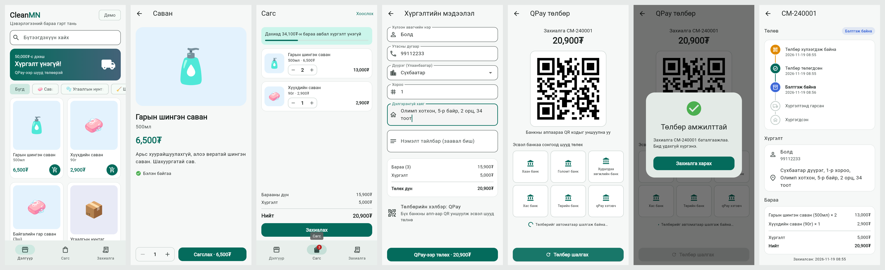

# CleanMN 🧼

Цэвэрлэгээний бүтээгдэхүүн (саван, угаалгын нунтаг, шүүр, ариутгагч, алчуур…) захиалах
Android + iOS апп. Flutter дээр бичигдсэн, төлбөрийг **QPay**-ээр авна.



## Функцууд

| | |
|---|---|
| 🛍 Бүтээгдэхүүн | Ангиллаар шүүх, хайх, дэлгэрэнгүй, тоо ширхэг сонгох |
| 🧺 Сагс | Тоо өөрчлөх, шудрах замаар устгах, төхөөрөмж дээр хадгалагдана, 50,000₮-с дээш үнэгүй хүргэлт |
| 📍 Хүргэлт | Нэр, утас (8 оронтой, +976 зөвшөөрнө), УБ-ын дүүрэг, хороо, хаяг, тайлбар. Сүүлийн хаягийг санана |
| 💳 QPay | QR код, банкны апп-ууд руу шууд холбоос, 5 сек тутам автомат шалгалт, банкны апп-аас буцаж ирэхэд шууд шалгана |
| 🚚 Төлөв хянах | Төлбөр хүлээгдэж байна → Төлөгдсөн → Бэлтгэж байна → Хүргэлтэнд гарсан → Хүргэгдсэн (цаг хугацаатай), 15 сек тутам шинэчилнэ |

## Ажиллуулах

```bash
flutter pub get
flutter run                      # Демо горим: backend шаардлагагүй, QPay-г дуурайлгана
```

Демо горимд "Төлбөр шалгах"-ыг дарахад (эсвэл 5 сек хүлээхэд) төлбөр төлөгдсөнд тооцогдоно,
дараа нь төлөв 20 секунд тутам автоматаар ахина.

Жинхэнэ backend-тэй:

```bash
# Android эмулятор → компьютерийн localhost нь 10.0.2.2
flutter run --dart-define=API_BASE_URL=http://10.0.2.2:8080
# Production
flutter build apk --release      --dart-define=API_BASE_URL=https://api.cleanmn.mn
flutter build ipa --release      --dart-define=API_BASE_URL=https://api.cleanmn.mn
```

Тест: `flutter test` (нэгж тест + бүтэн захиалгын урсгалын widget тест).

## Бүтэц

```
lib/
  main.dart, config.dart, theme.dart
  models/      product, cart_item, order (+ DeliveryInfo, QPayInvoice)
  data/        catalog.dart — демо каталог
  services/    api_service.dart (HTTP), mock_api_service.dart (демо), local_store.dart
  state/       catalog / cart / orders provider-ууд (provider package)
  screens/     shell, home, product_detail, cart, checkout, payment, orders, order_detail
  widgets/     product_card, status_timeline, quantity_stepper, ...
```

## Backend ба QPay

QPay-ийн нэвтрэх нэр/нууц үгийг **апп дотор хадгалж болохгүй** (апп-ыг задлаад авах боломжтой).
Тиймээс нэхэмжлэх үүсгэх, төлбөр шалгах нь `../cleanmn-server`-ээр дамжина. Тэнд дэлгэрэнгүй заавар бий.

Аюулгүй байдал:
- Үнийг сервер өөрийн каталогоос тооцно — клиентээс ирсэн үнэд итгэхгүй.
- Захиалга бүр санамсаргүй `token`-тэй; зөвхөн тэр token-оор харж/төлж болно.
- QPay callback-ийн payload-д итгэхгүй, QPay API-аас `payment/check` хийж баталгаажуулна.

## Production-оос өмнө

- [ ] QPay-тэй merchant гэрээ хийж, `QPAY_*` тохиргоог авах
- [ ] Бүтээгдэхүүний бодит зураг (`widgets/product_image.dart` дотор `Image.network`)
- [ ] Апп-ын icon, splash (`flutter_launcher_icons`, `flutter_native_splash`)
- [ ] Android release signing, iOS-ийн Team/Bundle ID (`mn.cleanmn.app`)
- [ ] Төлөв өөрчлөгдөхөд push мэдэгдэл (Firebase Cloud Messaging)
- [ ] Серверийн JSON файлын хадгалалтыг PostgreSQL зэрэг рүү шилжүүлэх
